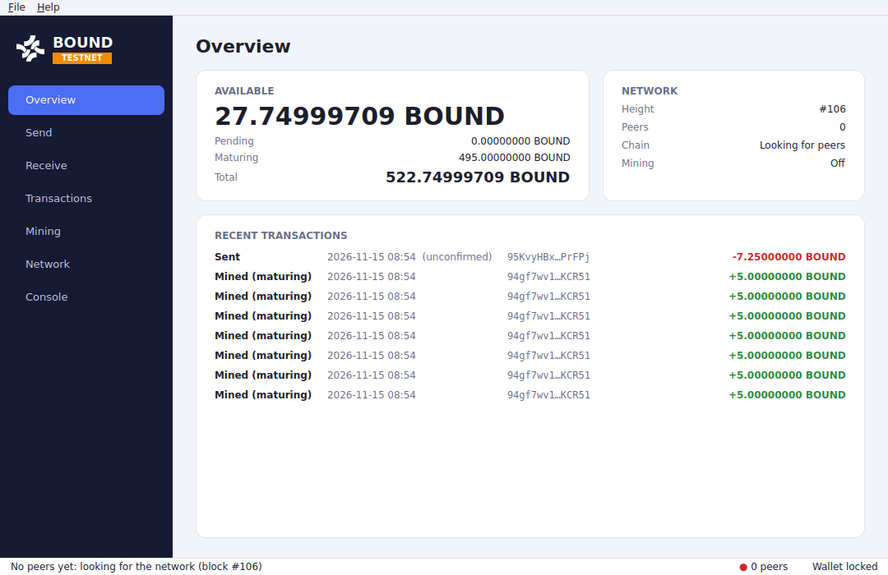

  <picture>
    <source media="(prefers-color-scheme: dark)" srcset="docs/logo-white.png">
    
  </picture>

<h1 align="center">BOUND</h1>

  A proof-of-work cryptocurrency written from scratch in C++20. 
  UTXO ledger · SHA-256d mining · Ed25519 signatures · its own P2P network, wallet and desktop app.

  
  
  
  
  

> [!NOTE]
> BOUND runs as a **testnet**, whose coins have no value. **Mainnet is on its way:** see the
> [road to mainnet](docs/mainnet-roadmap.md).

  

## What's inside

Everything is written here, the way Bitcoin Core does it, rather than borrowed from another coin:

- **Consensus.** Blocks and transactions are checked against every rule: double spends, Ed25519
  signatures, amounts, the block reward, coinbase maturity and difficulty. The node follows the
  valid chain with the most work and reorganises when another overtakes it.
- **Network.** Nodes talk over TCP: headers-first sync, block and transaction relay, and address
  gossip. A node finds its first peers through seeds, then advertises its own address so others can
  find it, much like Bitcoin. [Home nodes](docs/home-node.md) need no server.
- **Storage.** The chain lives in LevelDB and Bitcoin-style block files, and the node carries on
  where it stopped, even after a crash.
- **Payments.** They wait in each node's mempool until a block takes the best-paying ones. A
  higher fee can replace one (full RBF).
- **Wallet.** Every key comes from one seed, which is encrypted under a passphrase (Argon2id +
  XChaCha20-Poly1305). It sends, receives and bumps fees.
- **Desktop app.** `bound-qt` is a full node with a window, like Bitcoin-Qt. It has a wallet,
  payments, mining at the press of a button, the peers and an RPC console.
- **Defences.** A peer that breaks a rule is turned away for a day, and operators can ban
  addresses. Floods of low-work headers, unrequested blocks, requests or addresses can't stall or
  swamp a node. Every push is tested under AddressSanitizer, UndefinedBehaviorSanitizer and
  ThreadSanitizer, and everything that reads outside input is fuzzed
  ([milestone 12](docs/milestone-12.md), [consensus review](docs/consensus-review.md)). Found a
  vulnerability? See [SECURITY.md](SECURITY.md).
- **Infrastructure.** It comes with a DNS seeder (`bound-seeder`), a web block explorer
  (`bound-explorer`), JSON-RPC with `bound-cli`, and `bound-server`, which sets a Linux server
  up in one command per job: a node, the explorer over HTTPS, a seeder, health reports
  ([running a server](docs/running-a-server.md)).

## Download

Ready-made packages for Windows (the wallet app and the command-line programs) and Linux (x86-64 and
64-bit ARM) are on the
[releases page](https://github.com/Sonic-Bound/Bound/releases). Unzip and run: nothing else to
install. Each release lists the files' SHA-256 checksums, and GitHub attests that its own build
servers made every file from the tagged source: check one with
`gh attestation verify <file> --repo Sonic-Bound/Bound`. Releases are made the way
[docs/release-process.md](docs/release-process.md) describes.

## Join the testnet

Download it (above) or build it (below), then start the wallet app, or a node without a window:

    bound-qt                 # the desktop wallet: a full node with a window
    boundd node              # or a node on its own; talk to it with bound-cli

A new node finds the network on its own: it asks the built-in seeds (`seed.bound.sarl`,
`seed2.bound.sarl`), then learns about other nodes from its peers. To mine, open **Mining** in
the app and press *Start mining*, or start the node with `boundd node --mine <address>`.

**Explorer:** [explorer.bound.sarl](https://explorer.bound.sarl) shows the testnet's blocks,
transactions and addresses.

## Networks

Every program takes `--testnet` (the default until mainnet launches), `--mainnet` or `--regtest`,
and each network keeps its chain in its own data directory.

| | Testnet (live) | Mainnet (not launched yet) | Regtest |
|---|---|---|---|
| Block time | 60 seconds | 10 minutes | 10 minutes |
| Reward | 5 BOUND, halving every 2,100,000 blocks (~4 years) | 50 BOUND, halving every 210,000 blocks (~4 years) | 50 BOUND, halving every 150 blocks |
| Supply | 20,999,999.727 BOUND | 20,999,999.9769 BOUND, no premine | |
| Difficulty | retargets daily (1,440 blocks), at most 4× | ASERT (Bitcoin Cash's aserti3-2d), every block, 2-day half-life | fixed and trivial: any CPU, instantly |
| Addresses | start with `9` (51 characters) | start with `B` (52 characters) | start with `9` |
| Ports | P2P 18333, RPC 18332 | P2P 7333, RPC 7332 | P2P 18544, RPC 18543 |

Shared by all: 1 BOUND = 108 units; mined coins can be spent after 100 blocks; blocks of
at most 1 MB; timestamps at most 2 hours ahead; RPC on 127.0.0.1 only. Relay policy: at least 1 unit
per byte in fees, no outputs under 420 units, full RBF, at most 25 unconfirmed ancestors or
descendants.

The testnet's genesis is `0000a7ba8cc2ed04fa56bb3eaf23d5879874e7ffd060d81a2aca994f79b79293`, with
the message *"BOUND testnet 01/Nov/2026: a proof-of-work coin built from scratch in C++"*.
Mainnet's genesis is a placeholder until launch day: a node on it warns that its coins will be
thrown away.

## Build

<b>Linux</b> (tested on Ubuntu 24.04 with GCC 13)

    sudo apt install build-essential cmake ninja-build pkg-config libsodium-dev libleveldb-dev \
                     libsnappy-dev nlohmann-json3-dev libgtest-dev qt6-base-dev qt6-qpa-plugins
    cmake --preset linux
    cmake --build --preset linux-release
    ctest --preset linux-debug           # after cmake --build --preset linux-debug

The programs land in `build/linux/Release`. Without Qt everything but `bound-qt` still builds; add
`-DBOUND_GUI=OFF` to `cmake --preset linux` to skip it quietly. For a server, use a release
package and `bound-server` instead: see [running a server](docs/running-a-server.md).

<b>Windows</b> (Visual Studio 2022)

Install Visual Studio 2022 with *C++ CMake tools for Windows* and *vcpkg package manager*, then,
from **Developer PowerShell for VS 2022**:

    cmake --preset msvc                  # vcpkg builds the libraries the first time
    cmake --build --preset release
    ctest --preset debug                 # after cmake --build --preset debug

The programs land in `build\msvc\Release`. The wallet app needs Qt, which vcpkg builds from source
(one to two hours and a few GB of memory, once), so it's opt-in on Windows:
`cmake --preset msvc -DBOUND_GUI=ON`. Close other heavy programs first; on a machine with 8 GB,
`$env:VCPKG_MAX_CONCURRENCY = "4"` keeps the build from running out of memory.

## Using it

While a node runs (`bound-qt` or `boundd node`), `bound-cli` talks to it over JSON-RPC.
`bound-cli help` lists every method:

    bound-cli createwallet "passphrase"     # prints the seed: write it down
    bound-cli getnewaddress
    bound-cli setmining true                # mine in the background (setmining false stops)
    bound-cli walletpassphrase "passphrase" 600
    bound-cli sendtoaddress <address> 1.5
    bound-cli getwalletinfo
    bound-cli getnetworkinfo                # peers, and whether others can reach you
    bound-cli stop

More of the node:

    boundd node --connect <host[:port]>     # stay connected to a particular peer
    boundd node --index                     # keep the indexes the explorer needs
    boundd node --externalip <ip[:port]>    # where others reach you, if peers can't tell
    bound-explorer                          # a block explorer for that node: http://127.0.0.1:8080
    bound-seeder --host <seed name> --ns <this machine's name> --node <a node>
    boundd demo                             # in memory: mine, pay, lose it to a reorg, get it back

The chain is kept in `%APPDATA%\BOUND\testnet` on Windows and `~/.bound/testnet` on Linux, or
wherever `--datadir` points. Give the same one to `bound-cli`, `bound-qt` and `bound-explorer`.

## Roadmap

| # | Milestone | Status |
|---|---|---|
| 1 | Hashing, wire format, block header, proof of work, header chain | ✅ [notes](docs/milestone-1.md) |
| 2 | Keys, addresses, transactions, merkle tree, blocks, block reward | ✅ [notes](docs/milestone-2.md) |
| 3 | UTXO set, full validation, coinbase maturity, undo data, minimal wallet | ✅ [notes](docs/milestone-3.md) |
| 4 | Difficulty retargeting, block tree, most-work chain, reorgs | ✅ [notes](docs/milestone-4.md) |
| 5 | Storage: blocks and the UTXO set on disk, survive restarts | ✅ [notes](docs/milestone-5.md) |
| 6 | P2P networking: handshake, block relay, initial sync, address gossip | ✅ [notes](docs/milestone-6.md) |
| 7 | Mempool, transaction relay, wallet, command-line client / RPC | ✅ [notes](docs/milestone-7.md) |
| 7½ | Hardening: discouragement, bans, headers presync | ✅ [notes](docs/hardening.md) |
| 8 | Public testnet: seeds and a DNS seeder, block explorer, Linux, home nodes | ✅ [notes](docs/milestone-8.md) |
| 9 | Desktop wallet (`bound-qt`), background mining by RPC | ✅ [notes](docs/milestone-9.md) |
| 10 | Networks: mainnet, testnet and regtest side by side | ✅ [notes](docs/milestone-10.md) |
| 11 | ASERT difficulty for mainnet, checked against Bitcoin Cash's test vectors | ✅ [notes](docs/milestone-11.md) |
| 12 | Hardening: sanitizers and fuzzing in CI, Windows CI, consensus review, a multi-threaded miner | ✅ [notes](docs/milestone-12.md) |
| 13 | Releases: Windows and Linux packages built, tested and attested by GitHub Actions; `--version` | ✅ [notes](docs/milestone-13.md) |
| 14 | Launch infrastructure: `bound-server`, per-network services, explorer `/health`, ARM packages | tools ✅ [notes](docs/milestone-14.md); servers: 2 of 3 up, [explorer](https://explorer.bound.sarl) and 2 DNS seeders live |
| 15 | Mainnet launch | [road to mainnet](docs/mainnet-roadmap.md) |

## Layout

    src/util      hex, serialization, Base58
    src/crypto    SHA-256, Ed25519 (libsodium wrappers)
    src/core      consensus: uint256, pow, block, transaction, merkle, params, chain, coins,
                  validation, miner; storage: LevelDB, block files; policy: mempool, amounts
    src/net       P2P: sockets, protocol, addrman, peerman, connman, banman, headerssync, seeds
    src/wallet    passphrase encryption, the seed-derived wallet
    src/rpc       HTTP, JSON-RPC server and client, the methods
    src/node      the node itself, shared by boundd and bound-qt
    src/index     transaction, spent-output and address indexes (--index)
    src/explorer  the block explorer's pages
    src/seeder    the DNS seeder: crawler and DNS server
    src/qt        the desktop wallet
    src/app       boundd, bound-cli, bound-explorer, bound-seeder
    tests         GoogleTest suites, one per area
    docs          design notes for each milestone
    contrib       release packaging, bound-server, systemd units

## License

MIT: see [LICENSE](LICENSE).
